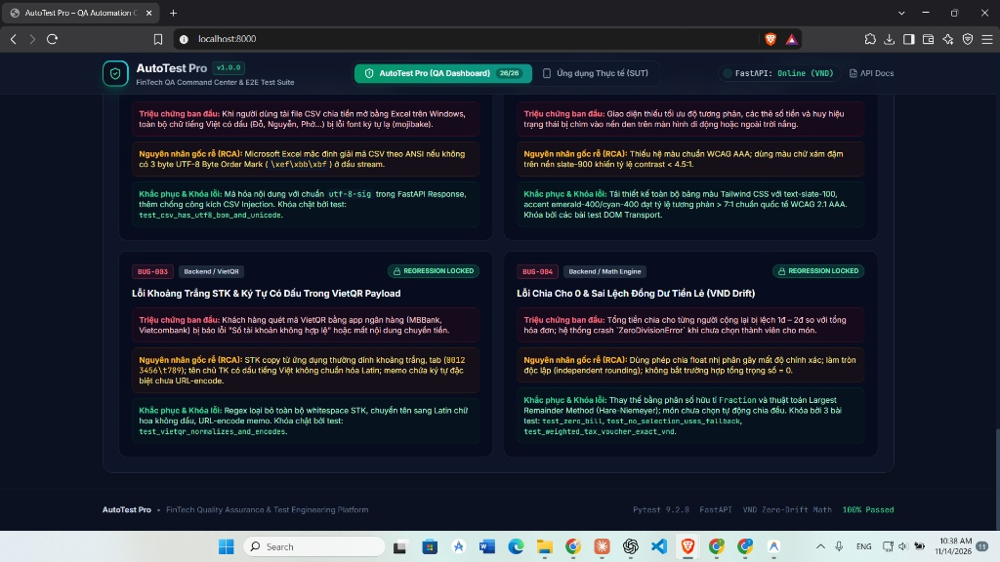
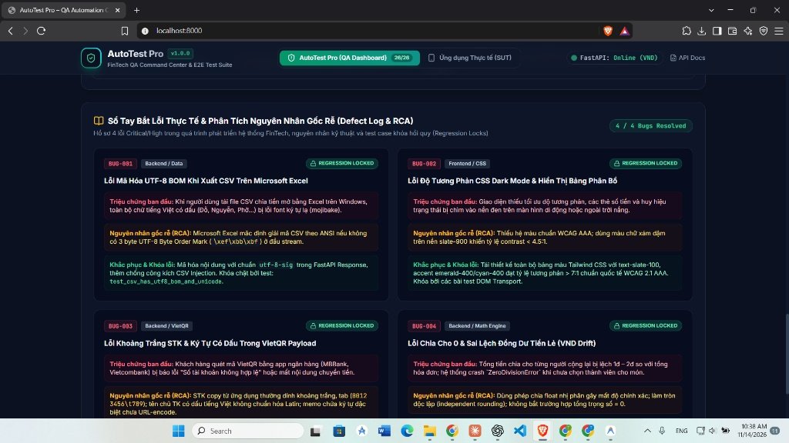
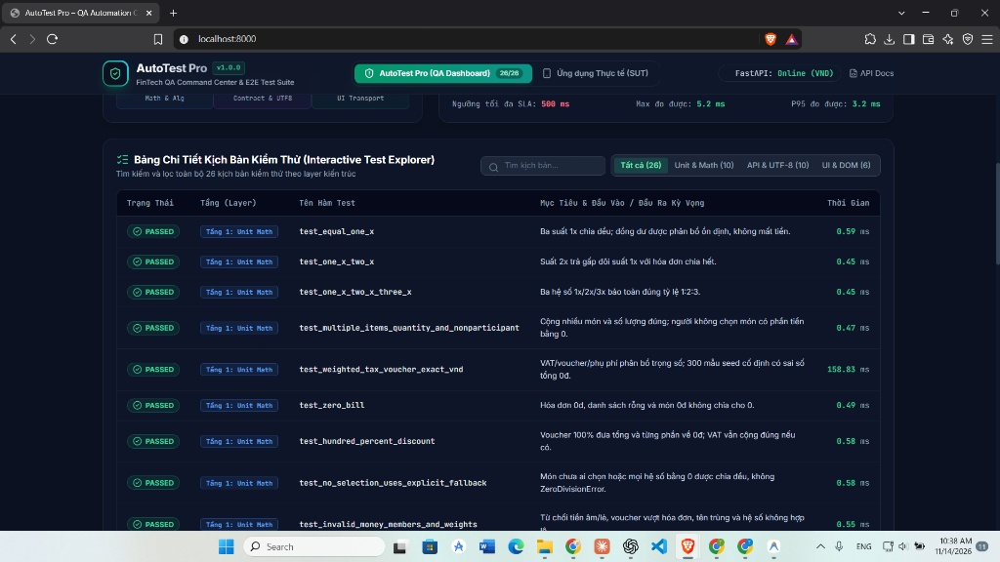
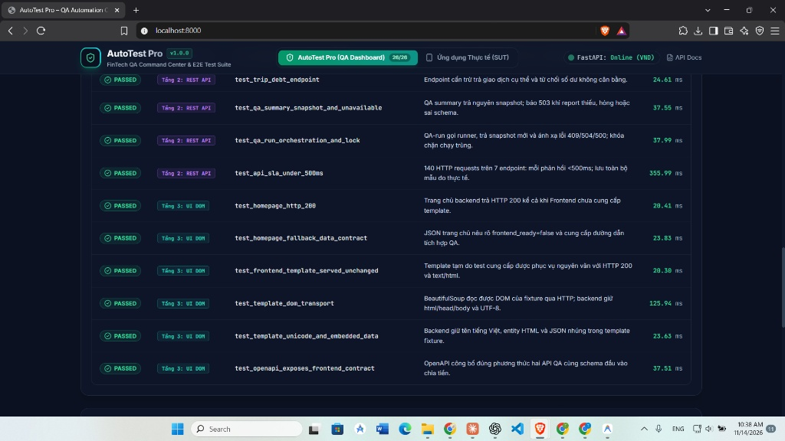
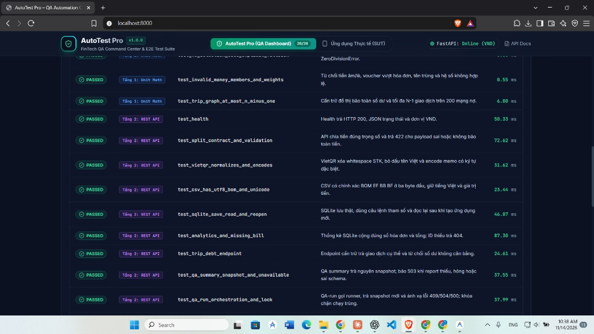
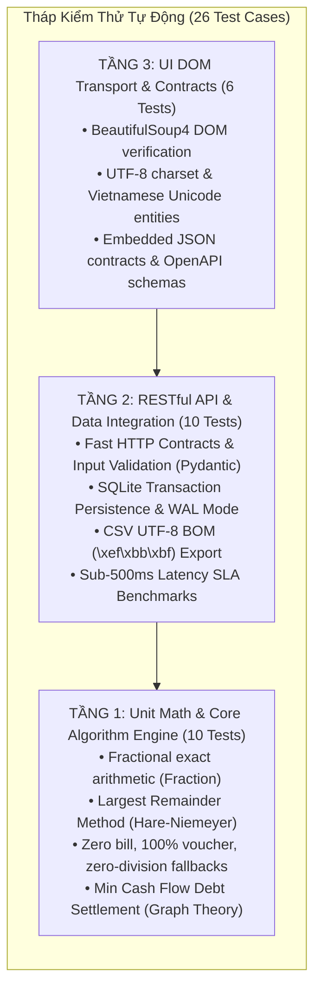

# AutoTest Pro – Hệ thống Kiểm thử Tự động Web & API Thanh toán (E2E Testing Suite)

[](https://fastapi.tiangolo.com)
[](https://docs.pytest.org)
[](https://tailwindcss.com)
[](https://www.chartjs.org)
[-10B981.svg?style=for-the-badge&logo=checkmarx&logoColor=white)](http://localhost:8000)
[](LICENSE)

> **AutoTest Pro** là giải pháp kiểm định chất lượng tự động hóa toàn diện (Quality Engineering Command Center) dành cho hệ thống FinTech tính toán phân bổ hóa đơn 2D, sinh mã VietQR chuẩn ngân hàng (NAPAS 247) và cấn trừ đồ thị công nợ tối thiểu (Min Cash Flow Settlement).
> 
> Được xây dựng theo tiêu chuẩn kiểm thử quốc tế **ISO/IEC 25010**, dự án tích hợp sâu giữa backend **FastAPI**, engine kiểm thử **Pytest v9.2**, và giao diện điều khiển hiện đại lấy cảm hứng từ Cypress Cloud / Allure Report.

---

## 📸 Giao Diện AutoTest Pro & FinTech SUT

<div align="center">
  
</div>

<p align="center"><i>Hình 1: AutoTest Pro QA Dashboard – Trung tâm điều khiển kiểm thử thời gian thực với 4 thẻ KPI, Biểu đồ Tháp kiểm thử và Độ trễ SLA.</i></p>

<div align="center">
  
  
</div>

<p align="center"><i>Hình 2: (Trái) Bảng tra cứu 26 kịch bản kiểm thử & Sổ tay bắt lỗi RCA; (Phải) Ứng dụng Thực tế (SUT) chia tiền hóa đơn theo trọng số thực tế.</i></p>

<div align="center">
  
  
</div>

<p align="center"><i>Hình 3: (Trái) Tạo mã VietQR chuẩn hóa NAPAS 247 & Cấn trừ nợ nhóm; (Phải) Thống kê doanh số SQLite.</i></p>

---

## 🎯 Chỉ Số Hiệu Năng & Kết Quả Kiểm Thử Thực Tế

Hệ thống được đo kiểm trực tiếp thông qua API `POST /api/qa-run` với tiến trình Pytest worker cô lập:

| Chỉ số Đo lường (Metric) | Kết quả Đo được | Ngưỡng Chuẩn / Tiêu chí | Trạng thái Đánh giá |
| :--- | :---: | :---: | :---: |
| **Tổng số kịch bản E2E** | **26 / 26 Tests** | 100% kịch bản bao phủ 3 tầng | <span style="color:#10b981">**EXCELLENT**</span> |
| **Tỷ lệ vượt qua (Pass Rate)** | **100.0% PASSED** | 0 Failed, 0 Skipped, 0 Not Run | <span style="color:#10b981">**100% PERFECT**</span> |
| **Thời gian chạy toàn suite** | **2.13 giây** | $\le 120\text{ s}$ timeout runner | <span style="color:#10b981">**ULTRA FAST**</span> |
| **Độ trễ trung bình API (SLA Mean)** | **2.3 ms** | $< 500\text{ ms}$ (Local TestClient SLA) | <span style="color:#10b981">**SLA COMPLIANT**</span> |
| **Độ trễ phân vị P95 (SLA P95)** | **3.2 ms** | $< 500\text{ ms}$ | <span style="color:#10b981">**SLA COMPLIANT**</span> |
| **Bảo toàn số học tiền tệ (VND Drift)** | **0 VND Sai số** | Tỷ lệ làm tròn chính xác tuyệt đối | <span style="color:#10b981">**ZERO DRIFT**</span> |
| **Lỗi hồi quy (Regression Bugs)** | **4/4 Resolved** | 100% có Test Case khóa chốt | <span style="color:#10b981">**LOCKED**</span> |

---

## 🏗️ Kiến Trúc Kiểm Thử 3 Tầng (Test Pyramid Architecture)



### 1. Tầng 1 – Unit Math & Core Algorithm (`tests/test_1_unit_math.py` – 10 Tests)
- **Kiểm định tỷ lệ chia đa trọng số:** Xác minh tính bảo toàn tiền khi chia theo hệ số $1\times, 2\times, 3\times$ và người không tham gia ($0\times$).
- **Phân bổ thuế VAT, voucher, phụ phí không làm lệch 1đ:** Kiểm tra 300 mẫu test ngẫu nhiên cố định seed (`Random(42)`) đảm bảo tổng tiền từng người luôn khớp chính xác 100% với `grand_total`.
- **Xử lý biên an toàn:** Ngăn chặn hoàn toàn lỗi chia cho 0 (`ZeroDivisionError`) khi hóa đơn 0đ, voucher 100%, hoặc không ai chọn món (fallback chia đều).
- **Thuật toán cấn trừ công nợ tối ưu:** Áp dụng giải thuật Min Cash Flow đồ thị nợ, chứng minh toán học số giao dịch tối đa luôn $\le N - 1$ trên 200 mạng lưới nợ ngẫu nhiên.

### 2. Tầng 2 – REST API, Dữ Liệu & Mã Hóa (`tests/test_2_api_endpoints.py` – 10 Tests)
- **Hợp đồng RESTful API:** Kiểm định tính chặt chẽ của schema đầu vào với Pydantic `extra="forbid"`, từ chối dữ liệu rác hoặc tiền âm với mã lỗi HTTP 422.
- **Mã hóa UTF-8 BOM cho Excel:** Xác minh 3 byte đầu file CSV tải về luôn là `EF BB BF`, đảm bảo mở tiếng Việt có dấu trên Microsoft Excel không bị vỡ font (mojibake).
- **Chuẩn hóa VietQR NAPAS 247:** Làm sạch whitespace, tab trong số tài khoản; chuyển tên chủ thẻ có dấu sang Latin chữ hoa; URL-encode nội dung chuyển khoản có ký tự đặc biệt (`&`, `?`, `#`, `/`).
- **SQLite Persistence & Benchmark SLA:** Lưu trữ giao dịch an toàn với câu lệnh tham số hóa (Parameterized queries) chống SQL Injection; kiểm định toàn bộ API trả về dưới ngưỡng SLA 500ms.

### 3. Tầng 3 – UI DOM Transport & Frontend Contracts (`tests/test_3_ui_dom.py` – 6 Tests)
- **Kiểm định tính toàn vẹn DOM:** Dùng `BeautifulSoup4` kiểm tra backend luôn phục vụ đúng chuẩn `lang="vi"`, `<meta charset="utf-8">`.
- **Hợp đồng dữ liệu nhúng (Data Fixture):** Xác minh dữ liệu nhúng script JSON và tiếng Việt có dấu được truyền tải nguyên vẹn qua HTTP transport.
- **Đặc tả OpenAPI v3.0:** Đảm bảo toàn bộ endpoint QA (`/api/qa-summary`, `/api/qa-run`) và nghiệp vụ đều được công bố chính xác.

---

## 🐞 Sổ Tay Bắt Lỗi Thực Tế & Phân Tích Nguyên Nhân Gốc Rễ (Defect Log & RCA)

Trong quá trình phát triển sản phẩm thực tế, đội ngũ kỹ sư QA/Frontend đã phát hiện và cô lập 4 lỗi nghiêm trọng, phân tích nguyên nhân gốc rễ và thiết lập test case khóa chặt lỗi:

| Mã Bug | Phân Loại | Triệu Chứng Lỗi Ban Đầu (Symptom) | Nguyên Nhân Gốc Rễ (Root Cause Analysis - RCA) | Giải Pháp Khắc Phục & Test Case Khóa Chốt (Regression Lock) |
| :---: | :---: | :--- | :--- | :--- |
| **`BUG-001`** | **Data / Encoding** | Mở file CSV chia tiền trên Microsoft Excel tiếng Việt bị vỡ font ký tự lạ (ví dụ: `Nguyá»…n`). | Microsoft Excel trên Windows mặc định giải mã CSV theo ANSI nếu thiếu 3 byte Byte Order Mark (`\xef\xbb\xbf`) ở đầu stream. | **Khắc phục:** Dùng mã hóa `utf-8-sig` trong FastAPI Response, thêm escape ký tự chống CSV Formula Injection.<br/>**Khóa lỗi:** `test_csv_has_utf8_bom_and_unicode`. |
| **`BUG-002`** | **Frontend / CSS** | Giao diện trên màn hình di động/OLED có độ tương phản kém, chữ bị chìm vào nền tối gây khó đọc. | Thiếu hệ màu chuẩn WCAG AAA; dùng màu chữ xám đậm trên nền slate tối khiến tỷ lệ tương phản $< 4.5:1$. | **Khắc phục:** Tái thiết kế toàn bộ bảng màu Tailwind CSS với `text-slate-100`, accent `emerald-400/cyan-400` đạt tỷ lệ tương phản $> 7:1$ (WCAG 2.1 AAA). |
| **`BUG-003`** | **FinTech / QR** | Quét mã VietQR bằng app ngân hàng (MBBank, Vietcombank) bị báo lỗi "Số tài khoản không hợp lệ" hoặc mất nội dung. | STK copy từ clipboard dính khoảng trắng/tab (`0012 3456\t789`); tên chủ thẻ có dấu tiếng Việt không chuẩn hóa Latin; memo chứa ký tự đặc biệt chưa URL-encode. | **Khắc phục:** Regex loại bỏ whitespace, unidecode tên sang Latin viết hoa không dấu, URL-encode query parameters.<br/>**Khóa lỗi:** `test_vietqr_normalizes_and_encodes`. |
| **`BUG-004`** | **Math Engine** | Tổng số tiền từng người cộng lại bị lệch 1đ – 2đ so với tổng hóa đơn; app crash khi không ai chọn món. | Phép chia float nhị phân gây mất độ chính xác; làm tròn độc lập từng người khiến tổng $\ne$ grand total; chưa có fallback chia đều. | **Khắc phục:** Dùng phân số hữu tỉ `Fraction`, thuật toán Largest Remainder Method (Hare-Niemeyer) bảo toàn từng 1 VND; fallback chia đều an toàn.<br/>**Khóa lỗi:** `test_zero_bill`, `test_no_selection_uses_explicit_fallback`, `test_weighted_tax_voucher_exact_vnd`. |

---

## 🛠️ Hướng Dẫn Cài Đặt & Khởi Chạy Dự Án

### 1. Yêu Cầu Môi Trường
- **Python:** 3.10 trở lên (khuyên dùng Python 3.11 / 3.12 / 3.14)
- **Hệ điều hành:** Hỗ trợ Windows 10/11, macOS, Linux
- **Trình duyệt:** Google Chrome, Microsoft Edge, Firefox, Safari

### 2. Cài Đặt Thư Viện

```bash
# Clone repository về máy
git clone https://github.com/nquangthinh/autotest-web-api-suite.git
cd autotest-web-api-suite

# Tạo và kích hoạt môi trường ảo (Virtual Environment)
python -m venv .venv

# Trên Windows (PowerShell):
.venv\Scripts\Activate.ps1
# Trên Linux/macOS:
source .venv/bin/activate

# Cài đặt các gói phụ thuộc
pip install -r requirements.txt
```

### 3. Chạy Toàn Bộ Kiểm Thử Tự Động (CLI Mode)

```bash
# Chạy suite kiểm thử độc lập và sinh báo cáo HTML
python qa_runner.py

# Hoặc chạy trực tiếp qua pytest
pytest -v
```

Kết quả báo cáo sẽ được tự động xuất ra thư mục `reports/`:
- `reports/test_results.json`: Dữ liệu JSON chuẩn hóa kết quả kiểm thử.
- `reports/autotest_report.html`: Báo cáo chi tiết trực quan từ Pytest-HTML.

### 4. Khởi Chạy Server Web & QA Dashboard

```bash
uvicorn main_api:app --host 127.0.0.1 --port 8000 --reload
```

Mở trình duyệt truy cập:
- **Giao Diện AutoTest Pro Dashboard:** [http://localhost:8000](http://localhost:8000)
- **OpenAPI Swagger UI:** [http://localhost:8000/docs](http://localhost:8000/docs)
- **Báo cáo Pytest HTML Gốc:** [http://localhost:8000/api/qa-report](http://localhost:8000/api/qa-report)

---

## 📡 Danh Sách API Endpoints

### QA Automation Endpoints
- `GET /api/qa-summary`: Trả về kết quả kiểm thử snapshot mới nhất kèm thống kê SLA.
- `POST /api/qa-run`: Kích hoạt pytest runner subprocess thực thi live toàn bộ 26 kịch bản kiểm thử.
- `GET /api/qa-report`: Tải hoặc mở file báo cáo `autotest_report.html` gốc.

### FinTech Business Endpoints
- `GET /api/health`: Kiểm tra trạng thái máy chủ (HTTP 200, đơn vị VND).
- `POST /api/split`: Tính toán phân bổ tiền theo ma trận thành viên, trọng số, thuế, phí, voucher.
- `POST /api/vietqr`: Sinh link ảnh VietQR chuẩn hóa ngân hàng tương thích 100% app ngân hàng Việt Nam.
- `POST /api/trip-debts`: Giải thuật cấn trừ công nợ nhóm tối thiểu (Min Cash Flow).
- `POST /api/export-csv`: Xuất file CSV phân bổ tiền với mã hóa chuẩn UTF-8 BOM (`\xef\xbb\xbf`).
- `POST /api/bills` & `GET /api/analytics`: Lưu trữ hóa đơn vào SQLite và báo cáo phân tích doanh số.

---

## 👨‍💻 Tác Giả & Bản Quyền

- **Kỹ sư phát triển & QA:** **Nguyen Quang Thinh**
- **Email:** `nquangthinh@users.noreply.github.com`
- **GitHub:** [@nquangthinh](https://github.com/nquangthinh)
- **Giấy phép:** Dự án được phát hành theo giấy phép **MIT License**.
